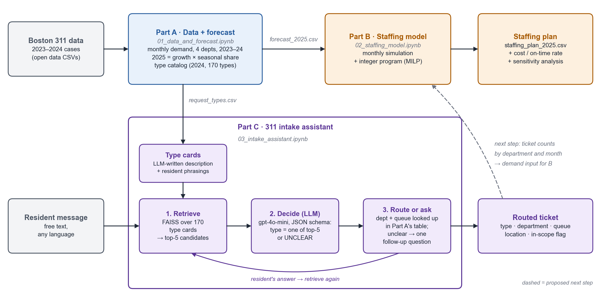
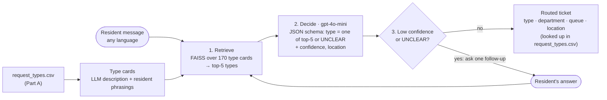

# Staffing Boston's 311 City Service Teams

IE 5374 Applied Generative AI, Module 7 Hackathon, Team 8

- **Report:** [report/Team8_Hackathon_Report.pdf](report/Team8_Hackathon_Report.pdf)
- **Demo video:** [Watch on Google Drive](https://drive.google.com/file/d/1kSjX3XDEYYAYla6GckAmvZLT0EcJZ4Mw/view?usp=sharing) (2:58)

We plan how many field crews four City of Boston departments need in each month of 2025. The four departments are Public Works, Transportation, Parks and Recreation, and Inspectional Services. We use real 311 request data from 2023 and 2024.

The project has three parts. Part A cleans the data, forecasts 2025 demand and builds a list of request types. Part B finds the lowest-cost staffing plan that still closes most requests on time. Part C is our GenAI application. It is a 311 intake assistant that reads a message from a resident and sends it to the right request type and department.

We recommend a plan that costs $14.77M in 2025 and closes 98% of requests on time. The intake assistant picks the right request type for 98% of our 45 test messages.

## Architecture



The dashed arrow is a proposed next step. Ticket counts from the assistant could give Part B new demand data every month.

## Repository Structure

```
01_data_and_forecast.ipynb    Part A
02_staffing_model.ipynb       Part B
03_intake_assistant.ipynb     Part C
data/                         CSV files made by Part A, and the test sets for Part C
outputs/                      result files from Part B and Part C, copied from our shared Drive folder
images/                       architecture diagram and charts
report/                       final report
```

The raw 311 files are about 175 MB each, so they are not in this repo. Part A explains how to download them.

## How to Run

Run the notebooks in order, 01 then 02 then 03. Part B and Part C read the files that Part A makes.

All three notebooks run in Google Colab and read data from `/content/drive/MyDrive/IE5374Project/Data/`. If the `IE5374Project` folder was shared with you, add a shortcut to it in "My Drive" first. If you do not have our shared folder, make the folder `IE5374Project/Data/` in your own My Drive and put the files from `data/` in it. Part C also needs an OpenAI API key. Each part below has its own steps.

## Part A: Data and Demand Forecast

**Notebook:** `01_data_and_forecast.ipynb`

This notebook cleans the Boston 311 data, forecasts monthly demand for 2025, and builds the request type list for the intake assistant. Run it first, because the other two notebooks use its output files.

### Input data
Download the 2023 and 2024 files from the 311 Service Requests page on Analyze Boston.
https://data.boston.gov/dataset/311-service-requests

- `lagan_311_open_data_2023_rvsd3.csv`
- `lagan_311_open_data_2024_rvsd3.csv`

### How to run
1. Put the two CSV files in a Google Drive folder.
2. Open the notebook in Google Colab.
3. Change `DATA_DIR` in the first code cell to your folder path.
4. Click Runtime and then Run all. It takes about two minutes.

### Output files
- `monthly_demand.csv` has monthly requests and on-time rate for the four departments in 2023 and 2024.
- `forecast_2025.csv` has the monthly forecast for 2025. The staffing model uses this file.
- `request_types.csv` has 170 request types, each with its main department, queue and example titles. The intake assistant uses this file.
- `request_types_all.csv` is the full list before we kept one department per type.

### AI use
We wrote the code and the first draft of this part with help from Claude by Anthropic. Then we checked every number against the notebook output.

## Part B: Crew Staffing Model

**Notebook:** `02_staffing_model.ipynb`

### What it does
Builds a month-by-month 2025 staffing plan for four Boston 311 departments (PWDx, BTDT, PARK, ISD): how many crews each department needs every month, and when to hire, release, or add Parks seasonal crews.

### How it works
1. **Simulation** (`simulate`): each month, capacity = crews × daily capacity × 21 days. Unfinished requests roll into the next month, oldest first. Overdue requests cost $20, and requests 30+ days late cost an extra $100.
2. **Optimization** (`optimize`): a mixed-integer program (`scipy.optimize.milp`) picks the lowest-cost plan that follows the brief's rules: 1-month hiring lead time, 25% release cost, and Parks seasonal crews from April to October at 1.3× cost.
3. **Comparison:** four plans are compared (keep January crews, lowest cost, 90% target, 95% target). Recommended: **90% target, $14.77M total cost, 98.0% on time**.
4. **Sensitivity analysis:** the plan is tested with demand ±20%, a February snowstorm spike, and a July heat wave spike.

### Inputs and outputs
- **Inputs (from Part A):** `forecast_2025.csv`, `monthly_demand.csv`
- **Outputs:** `staffing_plan_2025.csv` (crews by department and month), `plan_comparison.csv`, `sensitivity_results.csv`

### How to run
- **Google Colab:** add a shortcut to the shared `IE5374Project` folder in "My Drive", open the notebook, then Runtime → Run all. Data is read from and saved to `/content/drive/MyDrive/IE5374Project/Data/`.
- **Locally:** copy the two input CSV files from `data/` next to the notebook, then run all cells.
- **Packages:** `numpy`, `pandas`, `scipy`, `matplotlib` (already installed in Colab).

### AI use
The model code, charts and first draft of the report section were drafted with Claude (Anthropic). The assumptions were reviewed against the brief, and the notebook was run and checked in Colab to confirm the reported numbers match the output.

## Part C: 311 Intake Assistant

**Notebook:** `03_intake_assistant.ipynb`

### What it does

A resident describes a problem in plain language, in any language (for example "the light on my corner is broken"). The assistant:
- picks one of the 170 real 2024 request types;
- looks up the department and queue in Part A's table;
- pulls out the location;
- asks one follow-up question when the message could belong to different teams.

It also flags requests that are handled outside the four planned departments, such as water and sewer or needle pickup.

This is the project's GenAI application. It uses three course techniques: RAG, structured output and prompt engineering.

### How it works



- **Type cards (LLM data enrichment):**
  - 91 of the 170 types have example titles that only repeat the type name, so retrieval has little to match against.
  - gpt-4o-mini writes a short description and 4 resident-style phrasings for each type.
  - It uses a strict JSON schema and runs in batches of 10. The cards are cached in `type_cards.json`.
- **Retrieve (RAG):**
  - Each type card is embedded with `text-embedding-3-small` and stored in FAISS. The 5 closest types become the candidates.
  - After a follow-up, we retrieve twice, once on the answer alone and once on the message plus the answer. The two lists are merged, up to 10 types.
- **Decide (structured output):**
  - gpt-4o-mini, at temperature 0, returns JSON with `request_type`, `confidence`, `location` and `follow_up_question`.
  - The schema is built for each call, so `request_type` can only be one of the candidates or `UNCLEAR`.
- **Route or ask:**
  - Department, queue and the in-scope flag are looked up in `request_types.csv`. They are never generated by the LLM.
  - The assistant asks one question, in the resident's language, in two cases: confidence is `low` (candidates handled by different teams fit about equally), or the type is `UNCLEAR`.
- **Demo:** a Gradio chat app, in Section 6 of the notebook.

### Results

The test set (`intake_test_set.csv`) has 45 messages:
- 30 clear, 9 ambiguous, 5 handled outside the four departments, and 1 that is not a 311 request;
- it includes Chinese, Spanish and typo-heavy messages.

| Set-up | Type accuracy | Department accuracy | Asks when it should | Asks when it shouldn't |
|---|---|---|---|---|
| A · embedding top-1, basic cards | 49% | 80% | 0% | 0% |
| B · embedding top-1, type cards | 60% | 82% | 0% | 0% |
| C · RAG top-5 + LLM, basic cards | 76% | 89% | 40% | 0% |
| **D · RAG top-5 + LLM, type cards (final)** | **98%** | **98%** | **70%** | **0%** |
| E · all 170 types in the prompt + LLM | 89% | 98% | 10% | 0% |

- **Type cards help the most:** +11 points without the LLM (A → B) and +22 with it (C → D).
- **Retrieval vs. the full catalog:**
  - D and E both get every clear message right (100%).
  - E asks a follow-up only 10% of the time it should, so it guesses wrong on ambiguous messages.
- **The only wrong type:** "The light on my corner is broken", when the resident meant a traffic light.
  - All top-5 candidates were street-light types.
  - So the model had no option from another team to ask about.

### Inputs and outputs

- **Inputs (from Part A):** `request_types.csv`, the 170 types with department, queue and example case titles.
- **Test set:**
  - `intake_test_set.csv`: 45 messages, the current version (v2).
  - The changes from the first version (v1, 41 messages) are logged in Section 5 of the notebook.
- **Outputs (in `IE5374Project/C_intake/`):**
  - `type_cards.json`
  - `intake_predictions.csv`: every set-up on every message
  - `intake_eval_summary.csv`: the table above

### How to run

- **Google Colab:**
  1. Add a shortcut to the shared `IE5374Project` folder in "My Drive".
  2. Add your OpenAI key as the Colab secret `OPENAI_API_KEY` (key icon in the left sidebar), and turn on notebook access.
  3. Runtime → Run all.

  Data is read from `/content/drive/MyDrive/IE5374Project/Data/`, and outputs go to `IE5374Project/C_intake/`. The last section starts the Gradio demo inside the notebook.
- **Locally:**
  1. Put `request_types.csv` and `intake_test_set.csv` in a `data/` folder next to the notebook.
  2. Set `OPENAI_API_KEY`.
  3. Run all cells.
- **Packages:** `langchain-openai`, `langchain-community`, `faiss-cpu`, `gradio` and `pandas`. The first cell installs them.
- **API calls:** type cards are cached, so later runs only call the API for the evaluation and the demo.

### AI use

- The code, the first draft of the test set and the first draft of this section were written with Claude (Anthropic) and reviewed by the team.
- The type descriptions in `type_cards.json` are generated by gpt-4o-mini inside the notebook.
- The test messages were AI-drafted and checked by hand against the real type list.

## Team Contributions

- **Ruoxi Chen** did Part A. This includes data cleaning, the demand forecast, the request type list and the other considerations analysis.
- **Hanyue Zhu** did Part B. This includes the simulation, the optimization model, the plan comparison and the sensitivity analysis.
- **Weihe Pan** did Part C. This includes the type cards, the retrieval and decision steps, the test set, the evaluation and the Gradio demo.
- All three of us worked on the final report, this README and the demo video.
